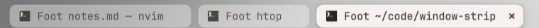

# Window Strip

Window tabs for the current workspace, shown under the Omarchy bar.



## Features

- One tab per window on the monitor's current workspace, in the scrolling
  layout's left-to-right order. Floating windows follow, marked with two small
  window outlines.
- Click a tab to focus its window. Middle-click a tab, or click its ×, to close
  the window. Closing asks the app politely, so unsaved-work prompts still
  appear.
- The focused tab is solid with full-strength text and a soft shadow. Other
  tabs stay dimmed and turn firmer on hover.
- App icons come from each app's desktop entry. Tab colors come from the
  current Omarchy theme, and corners follow Hyprland's window rounding.
- Scroll over the tabs to reveal more. The focused tab stays in view, and soft
  fades mark the edges that hide more tabs. Hover a tab to read its full title.
- Works per monitor. Special workspaces replace the normal list while open, and
  pinned windows appear on their monitor's current workspace.
- Hides with the status bar and under fullscreen windows. Maximized windows
  keep it, as they keep the bar.

## Requirements

- Omarchy with the Quickshell shell.
- Hyprland 0.56 or newer with the Lua config (the plugin dispatches
  `hl.dsp.focus` and `hl.dsp.window.close`).
- Python 3.

## Install

```sh
omarchy plugin add https://github.com/andy-spike/window-strip.git --enable
```

The strip reserves a row of at least 36 logical pixels under the bar. It grows
with larger font settings.

Disable or update it later:

```sh
omarchy plugin disable io.github.andy-spike.window-strip
omarchy plugin update io.github.andy-spike.window-strip
```

### Optional: bring activated windows into view

When an app activates a window on another workspace, for example a link
opening in your browser, Hyprland switches workspace and focuses the window.
The scrolling layout can still leave that window's column off-screen, and the
cursor warp can hand focus back to the window that is in view.
`extras/activation-focus.lua` fixes that by focusing the activated window
again, which scrolls it into view. Load it from `~/.config/hypr/hyprland.lua`:

```lua
dofile(os.getenv("HOME") .. "/.config/omarchy/plugins/io.github.andy-spike.window-strip/extras/activation-focus.lua")
```

Then validate the config:

```sh
hyprctl reload && hyprctl configerrors
```

## How it works

`windows.py` reads Hyprland's local IPC sockets. Relevant events refresh the
state at once, and a 50 ms fallback catches swaps and resizes that emit no
event. Window positions, monitors, and focus arrive in one batched compositor
request, so the state never mixes separate moments. Unchanged snapshots do not
update the UI. It reconnects if IPC disconnects.

`Service.qml` draws one strip per monitor on the overlay layer, below the
top-layer bar. Tabs are keyed by window address, so each window keeps its own
tab and focus state when windows reorder.

Inspect the live state:

```sh
omarchy-shell window-strip status
```

## Development

The tests use temporary IPC sockets and an offscreen Quickshell scene, so they
don't touch the live desktop:

```sh
python3 -m unittest -v test_windows.py test_qml.py
```

To work on a live copy, edit the files in
`~/.config/omarchy/plugins/io.github.andy-spike.window-strip/`. The shell
reloads plugin code on save. If an edit stays cached, run
`omarchy restart shell`.

## License

MIT
